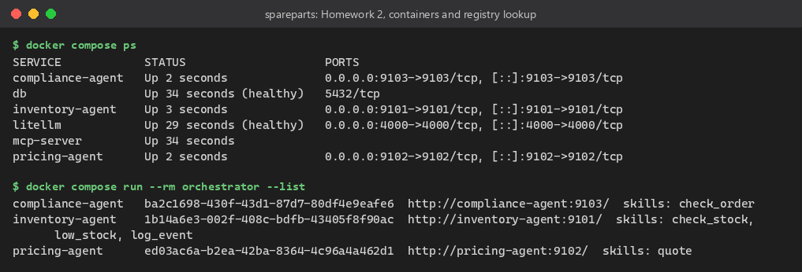
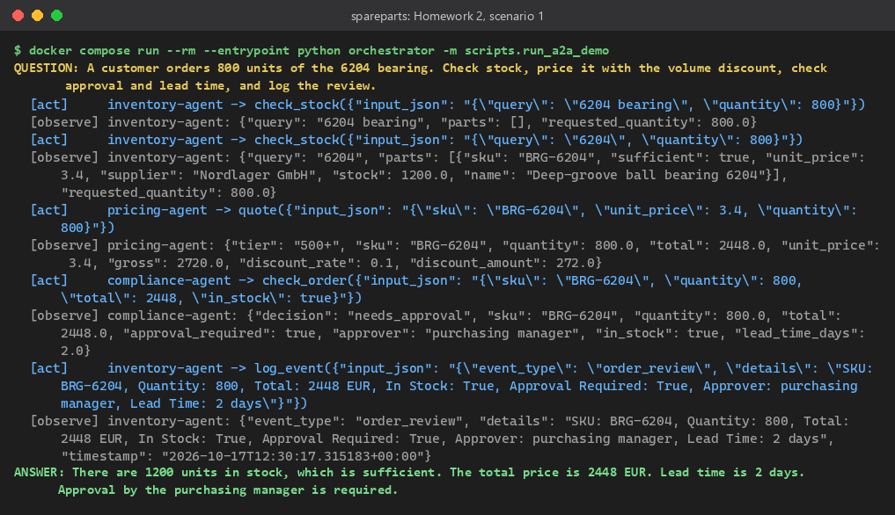
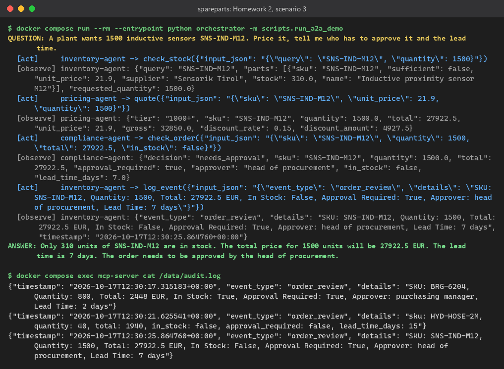

# Homework 2, Option A: Distributed A2A System with Dynamic Registry Lookup
Clemens Huber, 17 October 2026

**Repo:** TODO <public GitHub URL, add after the push>   **Execution logs:** [`execution_logs/a2a-demo-20261017-123006.md`](../execution_logs/a2a-demo-20261017-123006.md) (trace as `.jsonl` next to it)

## Idea
An order request ("800 bearings") needs three departments: inventory (stock), pricing (volume discount) and compliance (approval, lead time). Each is an independent A2A agent in its own container; an LLM orchestrator finds them at runtime in a registry and combines their answers.

## Architecture
```
orchestrator (ReAct loop, LiteLLM -> OpenRouter google/gemini-2.5-flash)
  -> LiteLLM proxy :4000 (agent registry + A2A gateway, Postgres)
     -> inventory-agent :9101  -> MCP server :8000 (Homework 1: SQLite inventory, audit log)
     -> pricing-agent   :9102  (tiered volume discount)
     -> compliance-agent :9103 (approval limits, lead times)
```

## Dynamic lookup
Agents publish an A2A agent card (official `a2a-sdk`, protocol 1.0) and register via `POST /v1/agents` on startup; the orchestrator calls `GET /v1/agents` and turns every skill into a tool. Adding a fourth agent needs no orchestrator change.

## Proof
Six containers, the three agents found in the registry, and two of the three order scenarios (`scripts/run_a2a_demo.py`):



 

| Scenario | Stock | Price | Lead time | Approval |
|---|---|---|---|---|
| 800 x BRG-6204 | 1200, enough | EUR 2448.00 (10 %) | 2 days | purchasing manager |
| 40 x HYD-HOSE-2M | 18, too few | EUR 1940.00 (no discount) | 15 days | none |
| 1500 x SNS-IND-M12 | 310, too few | EUR 27922.50 (15 %) | 7 days | head of procurement |

## Learnings
- In every scenario the orchestrator chained all three agents in the intended order (stock, quote, compliance, audit log) and passed the numbers from one agent to the next; in scenario 1 its first stock query ("6204 bearing") found nothing and it retried with the part number, the same lesson as in Homework 1.
- a2a-sdk 1.x sends data parts as protobuf Structs, so integers arrive as floats (800 -> 800.0, visible in the traces); every skill converts its inputs.
- The LiteLLM gateway routes on the A2A 0.3 top-level `url` of the card, so the agents add it when they register; the FastMCP server had to accept the Docker host name (`--allowed-host`), otherwise it answers 421.
