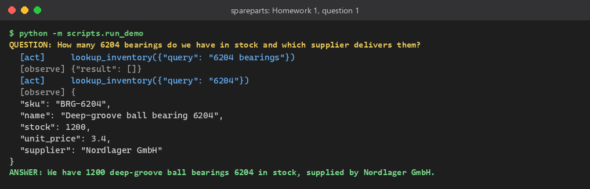
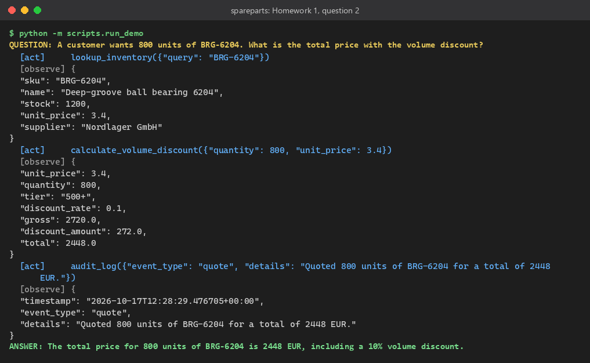
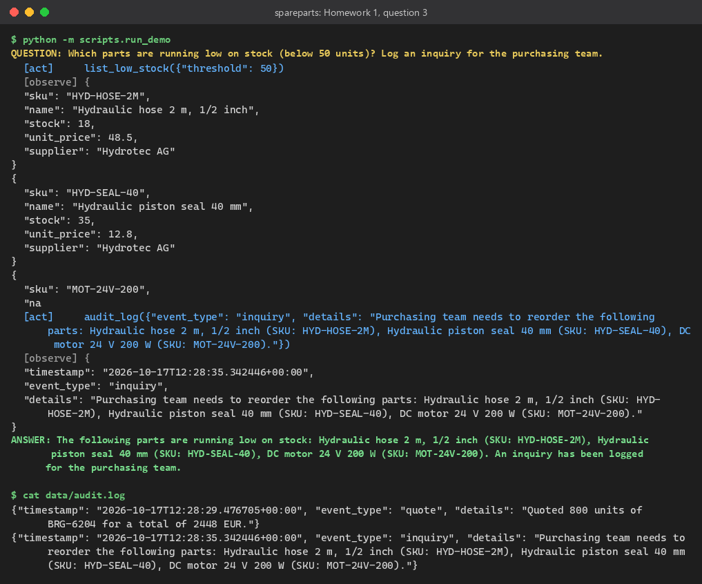

# Homework 1, Option A: Spare-Parts MCP Server
Clemens Huber, 17 October 2026

**Repo:** TODO <public GitHub URL, add after the push>   **Execution logs:** [`execution_logs/demo-20261017-142753.md`](../execution_logs/demo-20261017-142753.md) (trace as `.jsonl` next to it)

## Idea
A procurement assistant for an industrial spare-parts distributor answers stock, pricing and low-stock questions by calling tools instead of guessing. MCP fits because the inventory database, the discount engine and the audit file are exposed once as a standard server, so any MCP-capable agent or LLM can use them without a custom integration per pair (the M*N problem becomes M+N).

## Architecture
```
Agent (ReAct loop, LiteLLM -> OpenRouter google/gemini-2.5-flash, or local Ollama)
  -> MCP client session
    -> MCP server "spareparts" (FastMCP, stdio or Streamable HTTP via --transport)
      -> SQLite inventory (read-only connection) | discount engine | JSON-lines audit file (+ resource audit://log)
```

## Tools
| Tool | Purpose |
|---|---|
| `lookup_inventory` | Parametrised SQL search by SKU, name or supplier; returns stock, unit price, supplier |
| `calculate_volume_discount` | Tiered discount: 5 % from 100, 10 % from 500, 15 % from 1000 units; returns tier and totals |
| `audit_log` | Appends a timestamped event (quote, inquiry) to the audit file, readable as resource `audit://log` |
| `list_low_stock` | Parts below a stock threshold, lowest first |

## Proof
Three different questions, each answered through tool calls (terminal output of `python -m scripts.run_demo`):

 

1. **Inventory lookup:** the first search for "6204 bearings" finds nothing, the agent retries with "6204" and answers 1200 units from Nordlager GmbH.
2. **Quote:** lookup, then `calculate_volume_discount` (800 x EUR 3.40, tier 500+, 10 %: EUR 2448.00), then `audit_log`.
3. **Low stock:** `list_low_stock` finds three parts below 50 units; the inquiry for purchasing lands in `data/audit.log`.



## Learnings
- The model searched for the phrase "6204 bearings", the substring search found nothing, and because FastMCP sends an empty list without any text, the model saw an empty observation and gave up. Fix: the tool description asks for one short keyword, empty results are passed on as `{"result": []}`, and the prompt asks for one retry; now the agent recovers on its own (screenshot 1).
- Gemini sometimes states its answer before the last tool call and then ends with empty text, so the loop uses the last thought as the answer. Prompt rules are not guarantees: in question 1 the model skipped the audit entry the prompt asks for.
- Read-only by construction: queries open SQLite with `mode=ro` and only use bound parameters, so an injection string like `x'; DROP TABLE parts; --` simply matches nothing (covered by a pytest).
